<div align="center">

<a href="https://somedaytrip.vercel.app">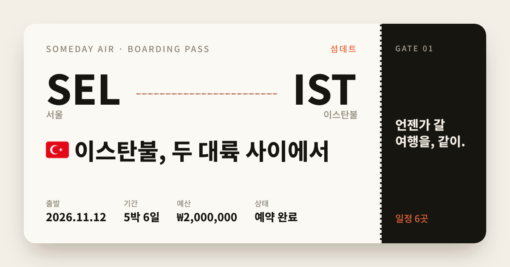</a>

# 섬데트 · SomedayTrip

**언젠가 갈 여행을, 같이.**

계획을 만들고 링크를 보내면, 친구는 일정을 **제안**하고 주인은 **수락**해요.<br>
GitHub의 Pull Request처럼, 여행 계획을 함께 다듬는 서비스입니다.

[**✈ 사이트 열기**](https://somedaytrip.vercel.app) · [같이 짜는 법](#-같이-짜는-법) · [화면](#-화면) · [직접 돌려 보기](#-직접-돌려-보기)


</div>

<br>

<p align="center">
  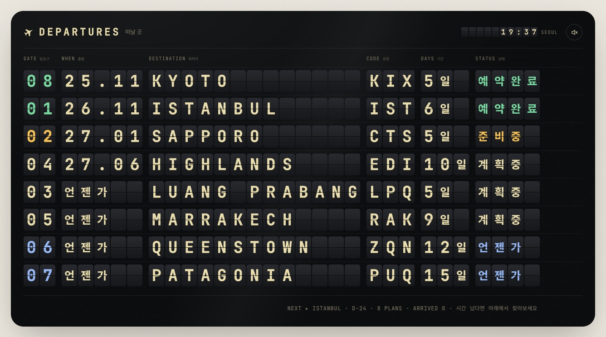
</p>

<br>

## ✦ 한눈에

| | |
|---|---|
| 🛫 **세계여행이 메인, 동네 여행도 OK** | 해외·국내·동네 중에 고르고, 날짜가 없으면 "언젠가"로 둬요 |
| 🔗 **링크 하나로 공유** | 링크를 받은 사람은 누구나 일정을 고칠 수 있어요. QR 코드도 돼요 |
| 📮 **고치면 제안이 돼요** | 친구가 고친 내용은 바로 반영되지 않고, 제안 바구니에 모였다가 한 번에 제안돼요 |
| 👑 **주인은 비밀번호로** | 가입이 없어요. 만들 때 정한 비밀번호를 아는 사람이 주인이고, 수락·거절을 해요 |
| ⚠️ **겹치면 알려 줘요** | 그 사이 같은 칸이 바뀌었으면 충돌로 표시하고, 겹치지 않는 것만 수락할 수 있어요 |
| 🌍 **링크 공개 / 전체 공개** | 기본은 친구끼리만이에요. 전체 공개로 바꾸면 Google·네이버 검색에 나와요 |

<br>

## 🧭 같이 짜는 법

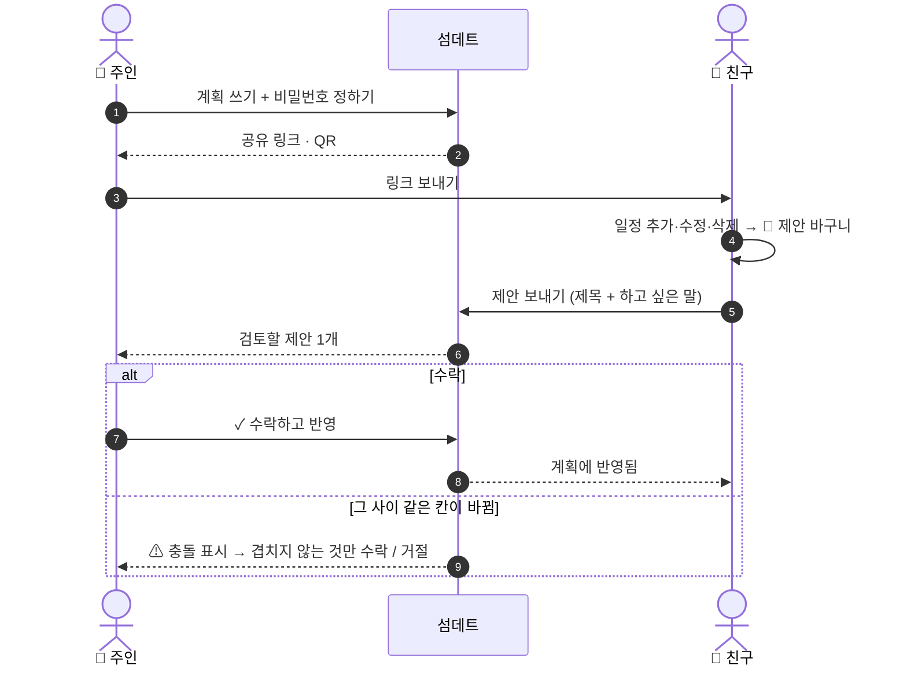

<table>
  <tr>
    <td width="50%">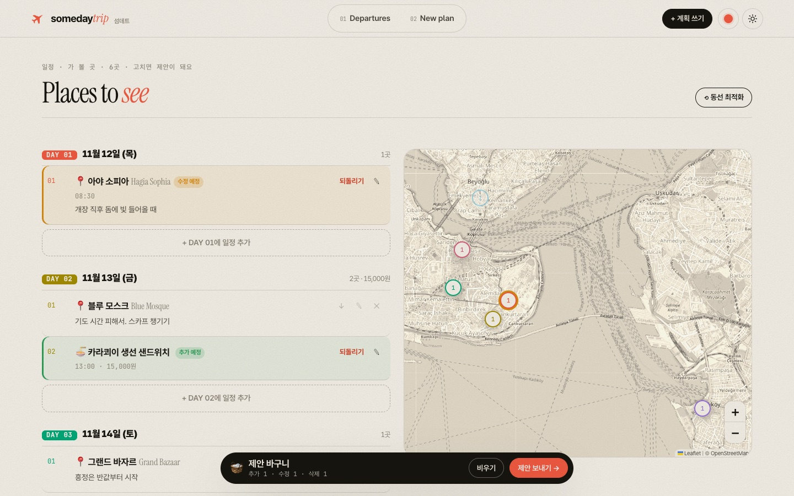</td>
    <td width="50%">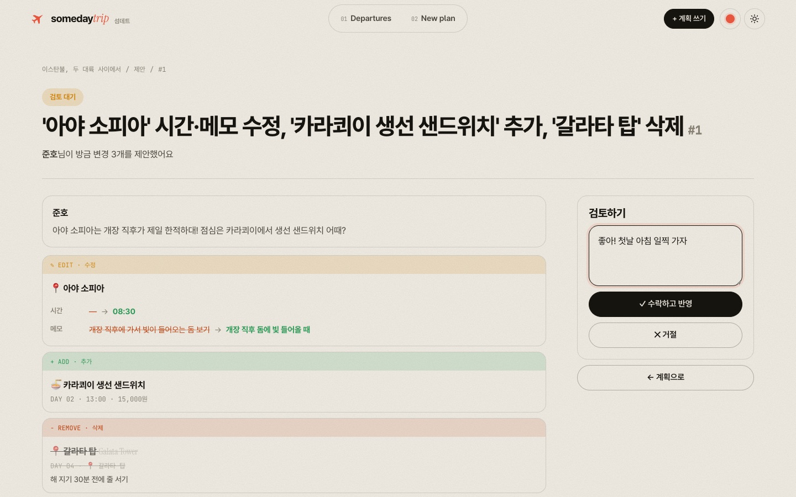</td>
  </tr>
  <tr>
    <td align="center"><b>🧺 친구 화면</b> · 고친 내용이 <em>추가·수정·삭제 예정</em>으로 모여요</td>
    <td align="center"><b>👑 주인 화면</b> · 바뀐 칸을 전 → 후로 보고 수락·거절해요</td>
  </tr>
</table>

<br>

## 🖼 화면

화면은 [moon.log](https://moonglog.vercel.app)의 Plans(가고 싶은 곳) 디자인을 그대로 가져왔어요.

<table>
  <tr>
    <td width="50%">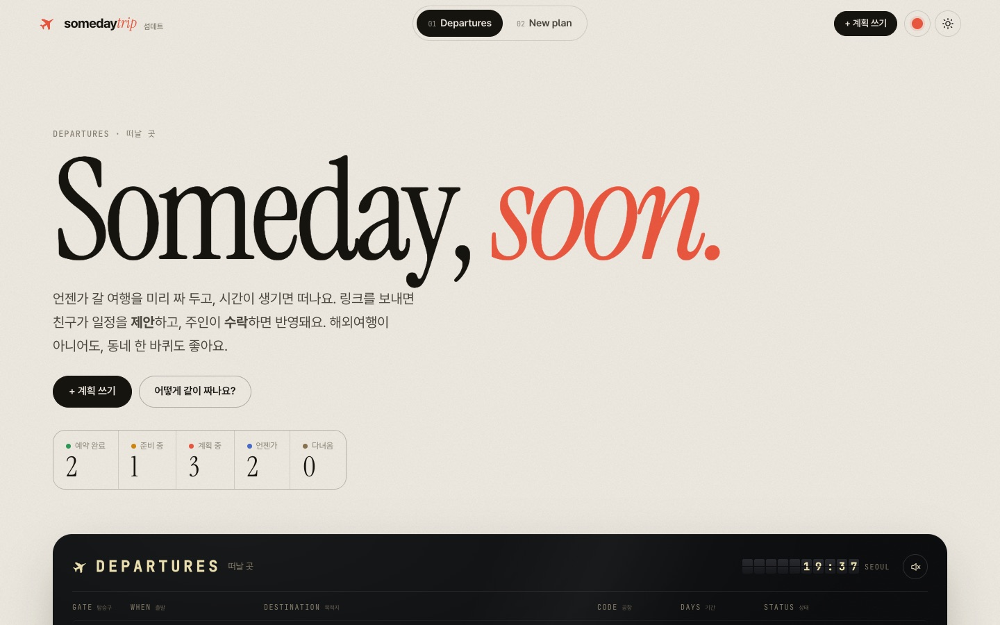</td>
    <td width="50%">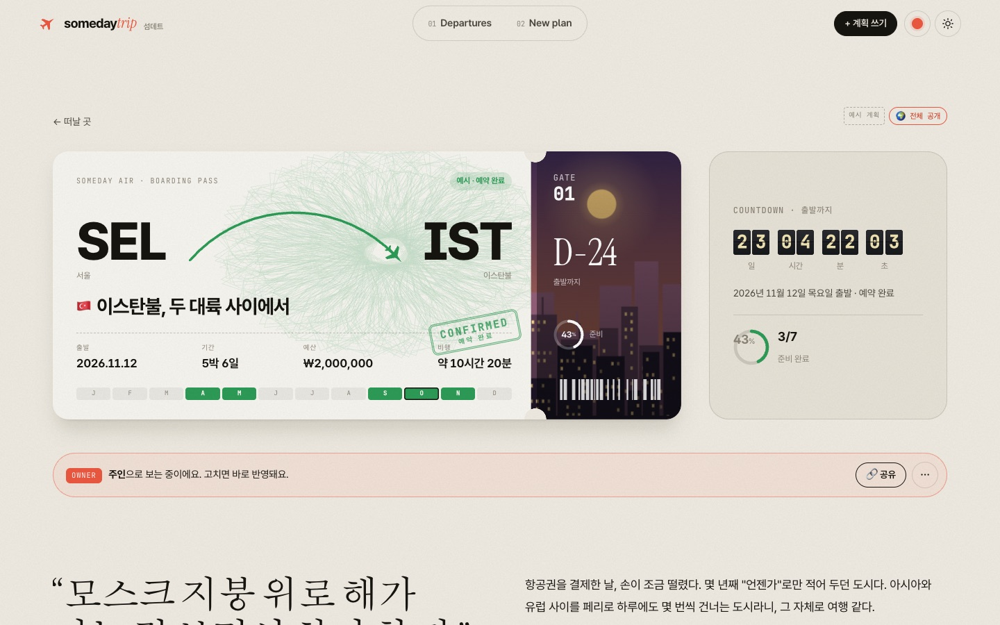</td>
  </tr>
  <tr>
    <td align="center"><b>떠날 곳</b> · 출발 전광판 · "시간 났다!" · 🎲 골라줘</td>
    <td align="center"><b>계획 상세</b> · 탑승권 · 카운트다운 플랩 · 현지 날씨·환율</td>
  </tr>
  <tr>
    <td>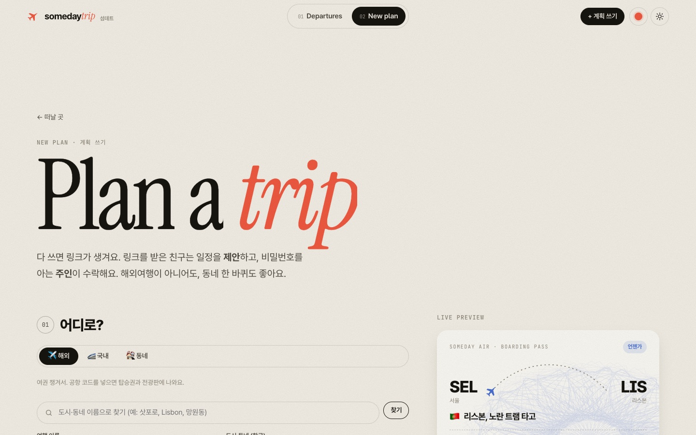</td>
    <td>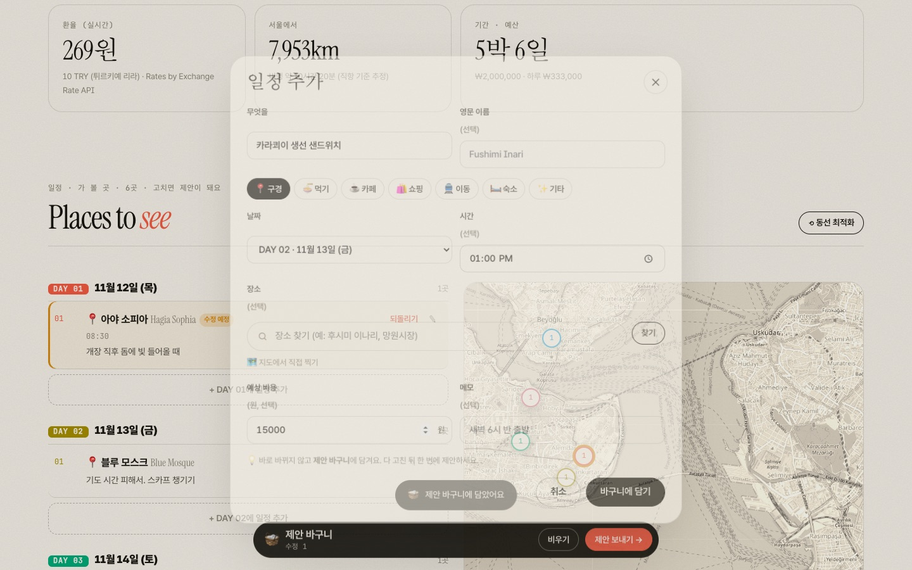</td>
  </tr>
  <tr>
    <td align="center"><b>계획 쓰기</b> · 7단계 작성기 · 실시간 탑승권 미리보기</td>
    <td align="center"><b>일정 추가</b> · 장소 검색 또는 지도에서 직접 찍기</td>
  </tr>
  <tr>
    <td>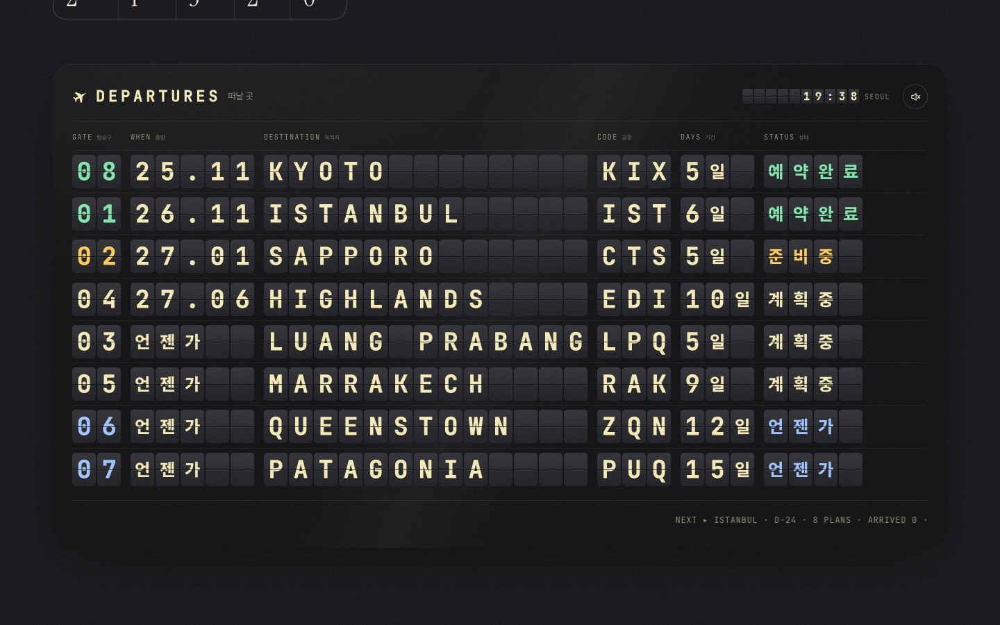</td>
    <td>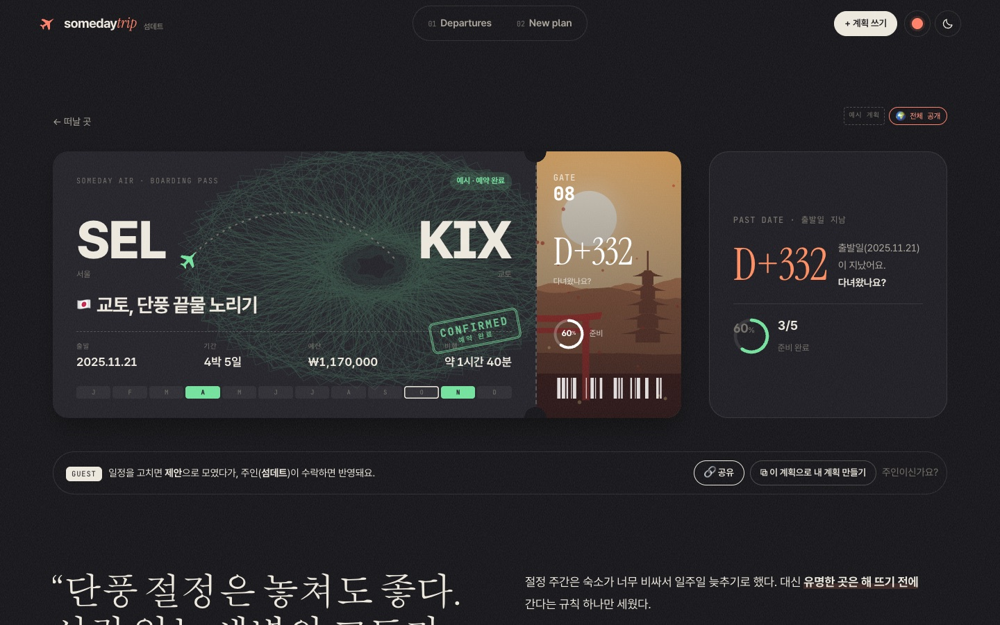</td>
  </tr>
  <tr>
    <td align="center" colspan="2"><b>다크 모드</b> · 시스템 설정을 따르고, 버튼을 누른 자리에서 원형으로 번져요</td>
  </tr>
</table>

<details>
<summary><b>🎫 탑승권 모아 보기</b></summary>
<br>
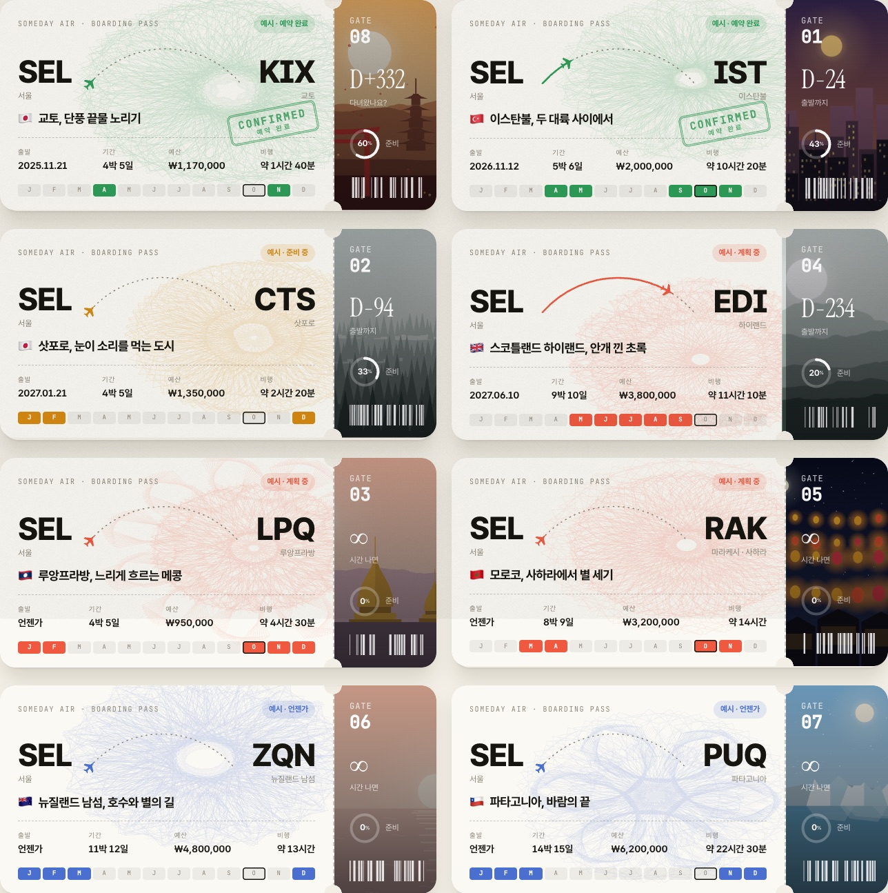
</details>

<details>
<summary><b>📱 모바일</b></summary>
<br>
<p align="center">
  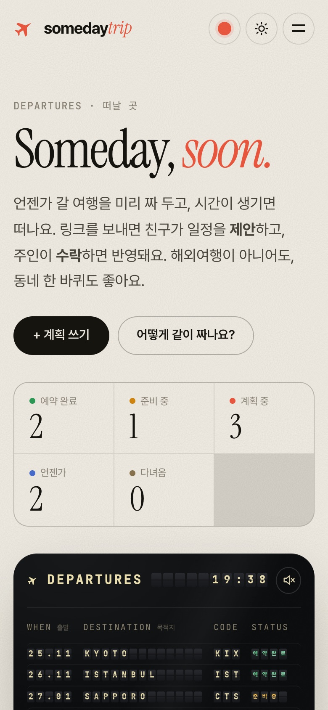
  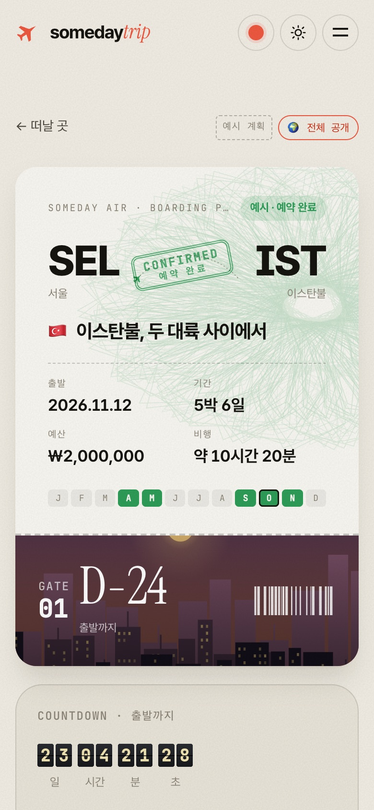
  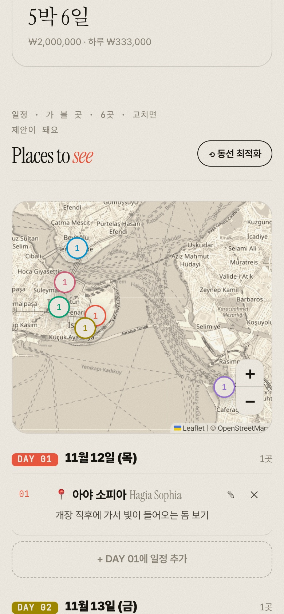
</p>
</details>

<br>

## 👑 주인과 보안

> 가입 없이, **비밀번호를 아는 사람이 주인**이에요. 쿠키를 지우거나 기기를 바꿔도 비밀번호만 다시 넣으면 돼요.

- 🔐 **비밀번호 원문은 저장하지 않아요.** PBKDF2-SHA256(15만 회) 해시와 솔트만 남겨요.
- 🍪 **인증은 서버가 해요.** 맞히면 계획별 **httpOnly 쿠키**에 토큰을 담아요. 브라우저 스크립트는 이 쿠키를 읽을 수 없어요.
- ⏳ **5번 틀리면 30초 잠겨요.** 그 뒤로는 틀릴 때마다 대기 시간이 두 배로 늘어요.
- 🔄 **비밀번호를 바꾸면** 다른 기기에 남아 있던 주인 인증이 모두 풀려요.
- 🚦 **제안 도배를 막아요.** 같은 사람은 10분에 5번까지 제안할 수 있고, 열린 제안은 50개까지예요. 주인은 열린 제안을 한꺼번에 거절할 수 있어요.
- 🧱 **DB는 서버만 만져요.** Supabase 모든 테이블에 RLS를 켜고 공개 권한을 거둬서, 공개(anon) 키로는 읽기도 쓰기도 막혀요. 브라우저에는 키가 하나도 없어요.

<details>
<summary><b>⚙️ 동시 수정은 이렇게 처리해요 (3-way 비교)</b></summary>
<br>

변경 하나는 "원래 값 → 바꿀 값"을 담아요. 수락할 때 **지금 계획**과 비교하고, DB에서는 계획 행을 잠근 채(`FOR UPDATE`) 한 트랜잭션 안에서 반영해요.

| 그 사이 무슨 일이? | 결과 |
|---|---|
| 다른 칸이 바뀜 (주인은 메모, 친구는 시간) | ✅ 둘 다 반영 |
| **같은 칸**이 다른 값으로 바뀜 | ⚠️ 충돌. "지금 계획에는 08:30으로 바뀌어 있어요" |
| 고치려던 일정이 지워짐 | ⚠️ 충돌 |
| 지우려던 일정이 이미 없음 | ✅ 통과 |
| 순서만 바뀜 | ✅ 충돌로 치지 않음 |

친구의 바구니 안에서 같은 일정을 여러 번 고치면 변경 하나로 합쳐지고, 원래 값으로 되돌리면 그 변경은 빠져요.
</details>

<br>

## 🔎 검색에 잘 나오게

검색 노출이 목표라서 **Next.js 서버 렌더링**을 골랐어요. 카카오톡과 네이버는 JS를 실행하지 않아서, 서버가 그린 HTML이 꼭 있어야 해요.

| | 링크 공개 (기본) | 전체 공개 |
|---|:---:|:---:|
| 볼 수 있는 사람 | 링크를 받은 친구 | 누구나 |
| 검색 노출 | ❌ `noindex` | ✅ |
| 사이트맵 · 구조화 데이터(`TouristTrip`) | ❌ | ✅ |
| 카톡·슬랙 링크 미리보기 | ✅ | ✅ |
| 일정 제안 · 주인만 반영 | ✅ | ✅ |

- **글자가 HTML에 들어 있어요.** 전광판과 탑승권 글자까지 서버가 HTML로 보내고, 애니메이션은 화면이 뜬 뒤에 돌아요.
- **정식 주소가 하나예요.** 계획마다 `/p/<id>/<slug>`를 canonical로 쓰고, 예전 주소는 308로 옮겨 가요.
- **링크 미리보기 그림이 탑승권이에요.** 맨 위 그림이 실제로 자동 생성되는 미리보기예요.
- **생성 그림은 따로 내려보내요.** 풍경과 위조방지 무늬는 별도 주소로 보내고 1년 동안 캐시해서, 페이지 HTML이 가벼워요.

<br>

## 🧱 만든 재료

| 영역 | 사용한 것 |
|---|---|
| 프레임워크 | Next.js 16 (App Router, 서버 액션) · React 19 · TypeScript |
| 데이터 | Supabase Postgres (Free, 서울) · [postgres.js](https://github.com/porsager/postgres) |
| 배포 | Vercel · 함수 리전 `icn1` (서울) |
| 지도 · 장소 | [Leaflet](https://leafletjs.com) · OpenStreetMap 타일 · [Nominatim](https://nominatim.org) |
| 실시간 정보 | [Open-Meteo](https://open-meteo.com) 날씨 · [ExchangeRate-API](https://www.exchangerate-api.com) 환율 |
| 디자인 | [moon.log](https://moonglog.vercel.app) Plans: 스플릿 플랩 전광판, 탑승권, 생성 풍경 그림 |
| 기타 | [qrcode](https://github.com/soldair/node-qrcode) · Instrument Serif · JetBrains Mono · Pretendard |

<details>
<summary><b>📁 폴더 구조</b></summary>

```
src/
  app/
    page.tsx                  떠날 곳 (홈)
    new/                      계획 쓰기 · ?from=<id> 공개 계획 복사
    p/[id]/[[...slug]]/       계획 상세 (서버 렌더링 · 메타데이터 · JSON-LD)
    p/[id]/edit/              계획 고치기 (주인만)
    p/[id]/pr/[no]/           제안 화면
    p/[id]/opengraph-image    링크 미리보기 그림
    art/                      풍경 · 위조방지 무늬 SVG
    actions.ts                서버 액션 (모든 쓰기, 주인 확인)
    sitemap.ts · robots.ts
  blog/                       moon.log에서 옮긴 템플릿·연출 (서버에서 HTML, 브라우저에서 움직임)
  components/                 Chrome · PlansExplorer · Composer · collab/ (일정 · 바구니 · 제안)
  server/                     repo.ts (업무 규칙 + 파일 저장소) · pg-repo.ts (Supabase) · auth.ts · secret.ts
  lib/                        types · proposals (병합·충돌) · clean (입력 검사)
  styles/blog/                moon.log CSS 그대로 + sdt.css (협업 UI)
supabase/migrations/          스키마 (RLS)
tests/                        vitest
```
</details>

<br>

## 🚀 직접 돌려 보기

```bash
git clone https://github.com/MoonG25/somedaytrip.git
cd somedaytrip
npm install
npm run dev          # http://localhost:3100
```

`DATABASE_URL`이 없으면 **개발용 JSON 파일**(`.data/db.json`)을 써요. 처음 실행하면 예시 계획 8개가 들어가요.

<details>
<summary><b>Supabase에 연결하기</b></summary>

1. Supabase 프로젝트를 만들고, 커넥션 풀러(트랜잭션 모드) 주소를 `.env.local`에 넣어요. **이 파일은 절대 커밋하지 마세요.**
   ```bash
   DATABASE_URL=postgres://postgres.<ref>:<password>@aws-0-<region>.pooler.supabase.com:6543/postgres
   ```
2. 스키마를 적용해요.
   ```bash
   node --env-file=.env.local scripts/migrate.mjs
   ```
3. 배포할 때는 Vercel 환경 변수에 `DATABASE_URL`을 **Sensitive**로 넣어요. 브라우저에 노출되는 `NEXT_PUBLIC_` 접두사는 붙이지 마세요.

| 환경 변수 | 설명 |
|---|---|
| `DATABASE_URL` | Supabase Postgres 주소. 없으면 JSON 파일 저장소 |
| `SDT_SAMPLE_PASSWORD` | 예시 계획의 주인 비밀번호 (선택). 없으면 아무도 모르는 값 |
| `NEXT_PUBLIC_SITE_URL` | 사이트 주소 (선택, 기본 `https://somedaytrip.vercel.app`) |
</details>

```bash
npm test             # 단위 테스트 (DATABASE_URL이 있으면 Supabase 통합 테스트도)
npm run build
```

<br>

## 🗺 다음

- [x] moon.log Plans 디자인 이식 (전광판 · 탑승권 · 작성기)
- [x] 제안 바구니 → 제안 → 수락·거절, 3-way 충돌
- [x] 비밀번호 주인 인증 (서버 · httpOnly 쿠키)
- [x] 링크 / 전체 공개 · 사이트맵 · OG 이미지
- [x] Supabase 연결 · 행 잠금 트랜잭션 · RLS
- [ ] Google Search Console · 네이버 서치어드바이저 등록
- [ ] 실시간 반영 (지금은 같은 브라우저 탭끼리는 즉시, 그 밖에는 30초마다)
- [ ] 여행지 페이지 `/destinations/<도시>`: 공개 계획 모음
- [ ] 카카오 로컬 API로 동네 장소 검색 개선
- [ ] 칸 단위 부분 수락

<br>

<details>
<summary><b>🧪 실험 노트</b> (AI Slop Lab 기록)</summary>

- **시작일**: 2026-10-19
- **상태**: 🔬 진행 중 · v0.2 배포 완료
- **출발점**: [moon.log](https://github.com/MoonG25/blog)의 Plans를 떼어 내서, 여러 사람이 같이 짜는 서비스로 만들었다. 블로그는 그대로 두었다.
- **흐름**
  1. **v0.1**: Vite판, 서버 없음 (태그 `v0.1.0-vite`)
  2. **v0.2**: 검색 노출을 위해 Next.js로 전환했다. 메인 컨셉을 세계여행으로 잡고 moon.log 디자인을 그대로 이식했다.
  3. **Supabase 연결**: 같은 날 연결해서 배포했다.

**결과**

- **단위 테스트 27개**
  - 3-way 충돌과 바구니 합치기
  - 비밀번호 해시 비노출, 잠금, 토큰 없는 쓰기 차단
  - 제안 횟수 제한, 일괄 거절, 비밀번호 변경 시 토큰 무효화
  - 입력 검사, 추가 일정 id 겹침
- **Supabase 통합 테스트 3개:** 동시 제안 10개의 번호가 겹치지 않음, 동시 수락 6개가 하나도 빠지지 않음, 잠금
- **브라우저 시나리오 38개, 콘솔 오류 0.** 로컬에서 두 번, 배포 사이트에서 한 번 돌렸다. 주인·손님·다른 기기·복사한 사람을 서로 다른 브라우저 세션으로 나눴다.
- **고친 버그:** 새 일정이 직전에 고친 일정의 id를 물려받아, 수락할 때 추가가 빠지는 일이 가끔 있었다. 일정 창, 저장할 때, 서버, 세 군데에서 막았다.

**한계**

- Supabase Free는 7일 동안 요청이 없으면 일시 정지된다.
- 충돌을 변경 단위로 판단한다. 한 일정의 시간과 메모를 같이 고쳤는데 시간만 겹쳐도 그 변경 전체가 빠진다.
- 손님은 일정만 제안할 수 있다. 계획 정보(제목·예산·체크리스트 문구)는 주인만 고친다.

</details>

<br>

<p align="center"><sub>Made with ✈ in Seoul · 예시 계획의 좌표는 실제 장소 기준이에요</sub></p>
